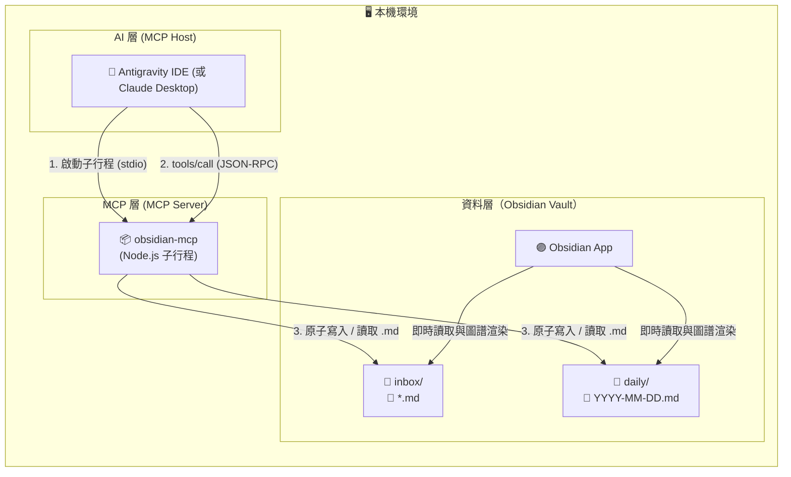

# Obsidian MCP Server (obsidian-mcp)

專為 Model Context Protocol (MCP) 設計的本機伺服器。支援 AI 代理（如 Antigravity IDE、Claude Desktop 等）透過標準化 stdio 協議直接讀寫本地 [Obsidian](https://obsidianmd.com/) Vault。

---

## 🎯 目標與非目標 (Goals & Non-Goals)

### 目標 (Goals)
1. **直接本機 Markdown I/O**：不依賴任何外部中繼資料庫或服務，直接讀寫 Vault 內的 `.md` 檔案，保持筆記資料的可攜性。
2. **無狀態架構 (Stateless)**：伺服器以 MCP Stdio 運作，隨叫隨用，無常駐背景 Daemon。
3. **嚴格安全防禦 (Hardened Security)**：以 `resolveSafePath` 與等冪 URL 解碼作為物理邊界，防禦路徑穿透、多重編碼逃逸與 Null Byte 注入。
4. **寫入原子性 (Atomic Writes)**：所有寫入與追加操作均透過同目錄臨時檔案替換完成，杜絕寫入中斷造成的檔案毀損。
5. **Token 預算防護 (Budget Guards)**：提供 `limit` 參數與結果截斷提示，防止大庫檢索時耗盡 LLM Context Window。

### 非目標 (Non-Goals)
1. **記憶體索引與變更監聽**：不實作 `fs.watch` 或常駐記憶體快取，檢索時直接由檔案系統解析。
2. **外部資料庫整合**：不引入 SQLite、向量資料庫或嵌入模型 (Embeddings)。
3. **分散式檔案鎖**：不實作複雜跨程序鎖佇列，依賴檔案系統原子替換保證單次寫入安全。
4. **專屬格式解析**：不支援 Obsidian Canvas (`.canvas`) 或專利二進位外掛格式。

---

## 🏗️ 系統架構圖

### 1. 部署與通訊架構



### 2. Vault 資料結構與 Frontmatter 規格

本伺服器直接管理 Markdown 檔案。新增筆記時自動寫入 YAML Frontmatter 元數據，支援 Obsidian 雙向連結 (`[[wikilink]]`) 與標籤系統：

```markdown
---
title: 系統架構筆記
date: 2026-11-18
tags: [architecture, mcp]
source: obsidian-mcp
---
```

---

## 🛠️ 提供的 10 大 MCP Tools (v2.1.0)

所有工具均受 `resolveSafePath` 物理邊界保護：

| Tool 名稱 | 模式 | 說明 | 主要引數 |
|:---|:---:|:---|:---|
| `vault_overview` | 唯讀 | **全庫知識圖譜體檢**：出入度統計、孤島筆記、未建幽靈連結與核心樞紐節點分析 | `limit?` (預設 20), `folder?` |
| `add_note` | 寫入 | 新增筆記，支援任意子目錄與自動遞迴建檔（原子寫入） | `title`, `content`, `folder?`, `tags?` |
| `append_to_note` | 寫入 | 安全追加內容至文末或精確插入特定標題下方，內建代碼區塊假標題防護 | `path`, `content`, `targetHeading?` |
| `update_frontmatter` | 寫入 | 原地增減標籤、更新狀態與自訂欄位，正文完整保留 | `path`, `addTags?`, `removeTags?`, `status?`, `customFields?` |
| `add_daily_log` | 寫入 | 追加內容至當日日誌頁 (`YYYY-MM-DD.md`)，不存在時自動初始化 | `content` |
| `get_note` | 唯讀 | 安全讀取指定筆記全文與 Frontmatter 元數據 | `path` |
| `list_notes` | 唯讀 | 列出筆記清單，支援目錄限定、標籤篩選與筆數上限 | `folder?`, `tag?`, `limit?` (預設 50) |
| `search_notes` | 唯讀 | 全文檢索筆記，支援標籤限定與長度受控摘要 | `query`, `tags?`, `folder?`, `limit?` (預設 10) |
| `get_backlinks` | 唯讀 | **雙向反向連結檢索**：查詢引用此筆記的所有來源與句子上下文，具備上限截斷保護 | `title`, `limit?` (預設 20) |
| `find_related_notes` | 唯讀 | **概念關聯推薦**：計算 Jaccard 相似度與一階直接雙向引用關聯 (Graph Distance = 1) | `path`, `limit?` (預設 5) |

---

## 🛡️ 安全威脅模型與防禦機制 (Threat Model & Security Policy)

伺服器在 I/O 邊界層建構防禦體系：

1. **路徑穿透防禦 (Path Traversal)**：
   - 透過 `resolveSafePath` 計算相對於 `VAULT_PATH` 的真實標準化路徑。
   - 所有輸入經過等冪收斂 URL 解碼 (`safeDecodeURI`)，杜絕 `%252e%252e` 多重編碼穿透。遇畸形編碼時安全降級，不引發未捕捉異常。
2. **Null Byte 注入防禦**：
   - 在路徑解析前攔截 Null Byte (`\0`)，直接拋出 `SecurityViolationError`。
3. **程式碼區塊語法屏蔽 (Code Block Sandboxing)**：
   - 內建 `stripCodeBlocks` 函式，程式碼區塊 (```` ``` ```` 或 `~~~`) 內之註解與語法示範不被誤判為 Markdown 標題或雙向連結。
4. **檔案寫入原子性 (Atomic I/O)**：
   - 使用 `atomicWriteFileSync`，先寫入同目錄隨機暫存檔案 (`.tmp.<timestamp>.<rand>`)，再透過 `fs.renameSync` 原子替換，避免寫入中斷損毀筆記。
5. **Token 預算限制 (Budget Limiting)**：
   - 檢索與圖譜工具全數內建 `limit` 參數與截斷提示，防禦超大型 Vault 造成的 Prompt 膨脹與 DoS。
6. **節點身份唯一性**：
   - 跨目錄同名檔案（如 `a/README.md` 與 `b/README.md`）以相對路徑作為主鍵，圖譜分析時互不覆蓋。

---

## ⚖️ 替代方案評估 (Alternatives Considered)

| 評估維度 | Obsidian Local REST API 外掛 | 本地 SQLite 向量資料庫快取 | **obsidian-mcp (本專案)** |
|:---|:---|:---|:---|
| **常駐需求** | 必須持續開啟 Obsidian 桌面端 | 需常駐維護背景更新行程 | **無常駐行程** (Stdio 隨叫隨用) |
| **資料一致性** | 依賴外掛記憶體狀態 | 外部手動編輯時易產生索引漂移 | **即時檔案 I/O** (直接反映磁碟真實狀態) |
| **安全邊界** | 需開放 HTTP 本地端口與金鑰管理 | 需防範資料庫注入 | **純標準輸入輸出 (stdio)**，無網路暴露面 |
| **維護成本** | 需隨 Obsidian 外掛 API 升級更新 | 需維護 SQLite schema 與 migrations | **零外部依賴**，純 Node.js 原生 API |

---

## 🚀 安裝與設定

### 環境要求
- Node.js (v18 或以上)
- 一個存放 Markdown 筆記的目錄（Obsidian Vault 根目錄）

### 1. 編譯專案
```bash
npm install
npm run build
```

### 2. MCP 設定

在 AI 客戶端（例如 Antigravity IDE 或 Claude Desktop）的 MCP 設定檔中，加入以下配置：

```json
{
  "mcpServers": {
    "obsidian-mcp": {
      "command": "node",
      "args": ["d:/codespace/projects/obsidian-mcp/dist/index.js"],
      "env": {
        "VAULT_PATH": "d:/codespace/docs"
      }
    }
  }
}
```

> **注意**：`VAULT_PATH` 為唯一必要的環境變數，指向您的 Vault 根目錄。路徑分隔符號在 Windows 下建議使用正斜線 (`/`)。

### 3. 測試執行
可執行完整自動化測試套件驗證安裝：
```bash
npm test
```
