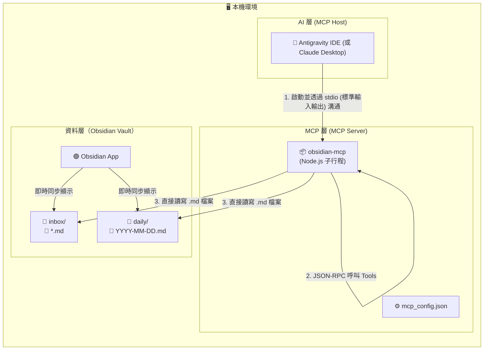

# Obsidian MCP Server (obsidian-mcp)

這是一個專為 Model Context Protocol (MCP) 設計的本地伺服器，旨在讓 AI 代理（如 Antigravity IDE、Claude Desktop 等）能夠直接讀寫您的 [Obsidian](https://obsidianmd.com/) Vault。

---

## 📖 什麼是 MCP (Model Context Protocol)?

**MCP** 的全名是 **Model Context Protocol**（模型上下文協定）。

它是由 Anthropic（Claude 模型的開發商）所推動的一項開源標準協定。您可以把它想像成是「**AI 界的 USB Type-C 介面**」。

### 解決了什麼問題？
在過去，如果想讓 AI 幫您讀取本地檔案、查詢資料庫、或操作特定的應用程式，每個 AI 工具（如 ChatGPT, Claude, GitHub Copilot）都需要開發專屬的外掛（Plugins）。這導致生態系非常破碎。

MCP 提出了一個標準化的雙向溝通協定。只要開發**一次** MCP Server（例如我們現在做的 `obsidian-mcp`），任何支援 MCP 標準的 AI 客戶端（Host）都能夠直接連上它，並取得它的能力。

### MCP 的三大核心功能：
1. **Resources (資源)**：讓 AI 可以讀取您的資料（例如：讀取特定檔案內容、API 回傳的資料）。
2. **Tools (工具)**：讓 AI 可以代替您執行動作（例如：新增筆記、發送 API 請求、控制智慧家電）。這也是我們本專案主要使用的功能。
3. **Prompts (提示詞)**：提供標準化的對話範本給 AI 使用。

**簡而言之：MCP 讓 AI 能夠以安全、標準化的方式，打破沙盒限制，安全地「看見」並「操作」您的本地電腦資源。**

---

## 🏗️ 系統架構圖

### 1. 部署與通訊架構



### 2. Vault 資料結構與 Frontmatter

本專案的核心理念是**直接讀寫 Markdown 檔案，不依賴任何中間資料庫**。寫入的筆記會自動帶有以下格式的 Frontmatter Metadata，確保能與 Obsidian 原生的標籤及 Graph View 完美整合：

```markdown
---
title: 買牛奶
date: 2026-09-01
tags: [ai-note, inbox]
source: obsidian-mcp
---
```

---

## 🛠️ 提供的 MCP Tools

本伺服器註冊了以下工具供 AI 使用：

| Tool 名稱 | 說明 | 寫入/讀取目標 |
|:---|:---|:---|
| `add_note` | 新增一則筆記（可指定標題、內容、標籤） | `inbox/<title>.md` |
| `add_daily_log` | 追加內容至當天的日誌頁，若不存在則自動建立 | `daily/YYYY-MM-DD.md` |
| `get_note` | 讀取指定路徑的筆記全文 | 唯讀 |
| `list_notes` | 列出 Vault 內所有筆記與 metadata（支援資料夾過濾） | 唯讀 |
| `search_notes` | 跨檔案全文關鍵字搜尋 | 唯讀 |

---

## 🚀 安裝與執行

### 環境要求
- Node.js (v18 或以上)
- 您的本機需要有一個用來存放 Markdown 檔案的資料夾（如 Obsidian Vault 或本專案使用的 `docs/`）。

### 1. 編譯專案
```bash
npm install
npm run build
```

### 2. MCP 設定

在您的 AI 客戶端（如 Antigravity IDE）的 MCP 設定檔中，加入以下配置：

```json
{
  "mcpServers": {
    "obsidian-mcp": {
      "command": "node",
      "args": ["/絕對路徑/至/obsidian-mcp/dist/index.js"],
      "env": {
        "VAULT_PATH": "/絕對路徑/至/您的/Obsidian Vault"
      }
    }
  }
}
```

> **注意**：`VAULT_PATH` 是唯一需要您指定的環境變數，它指向您的筆記根目錄。

### 3. 重啟 AI 客戶端
設定完成後，重新載入您的 AI 客戶端 MCP 連線。接著，您就可以直接對 AI 說：「幫我記下...」或是「搜尋我 Vault 裡面關於...的筆記」了！
