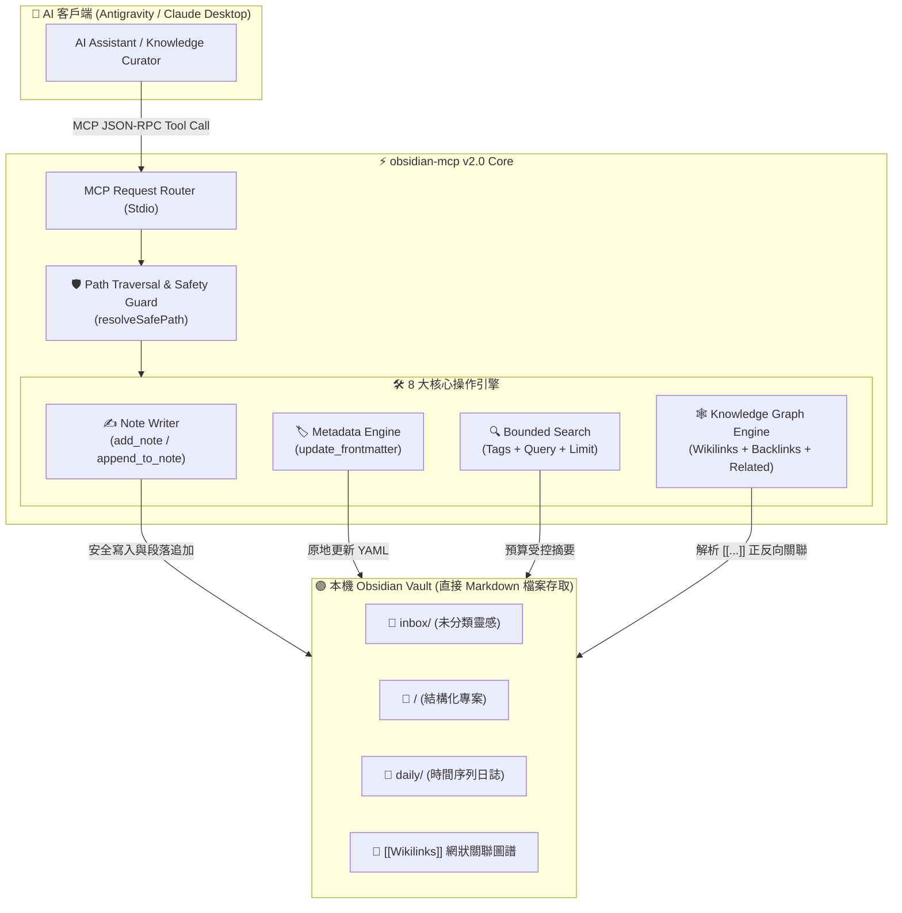

# 🧠 Obsidian MCP v2.0 系統架構與實作規格書 (Arena Synthesized Spec)

> **版本**：v2.0-Alpha (Arena Synthesis & Golden Benchmark)  
> **由來**：透過 `/arena` 雙候選方案對決（Candidate 1 極簡原生串流派 vs. Candidate 2 知識圖譜索引派）綜合嫁接產出。  
> **基底選型 (Base)**：Candidate 1 (純淨無狀態與高可靠檔案系統操作)  
> **移植嫁接 (Grafted)**：Candidate 2 之雙向連結圖譜解析、Jaccard 關聯概念推薦、孤島筆記體檢。

---

## 🏛️ 系統架構總覽 (Architecture Flowchart)



---

## 🦾 八大標準 MCP 工具清單 (Tools Specification)

### 1. `add_note`（目錄自由建立）
* **說明**：在指定目錄下建立新筆記，自動遞迴建立子目錄，防止 inbox 爆炸。
* **參數**：
  * `title` (string, 必填): 筆記標題（同時作為檔名）。
  * `content` (string, 必填): Markdown 正文。
  * `folder` (string, 可選): 相對目錄（如 `"projects/cdp-mcp"`，預設為 `"inbox"`）。
  * `tags` (string[], 可選): 標籤清單。

### 2. `append_to_note`（安全追加與段落補丁）
* **說明**：在指定筆記的最末尾、或指定標題（Heading）下方追加內容，絕不覆寫原有內容。
* **參數**：
  * `path` (string, 必填): 筆記相對路徑（如 `"projects/cdp-mcp/notes.md"`）。
  * `content` (string, 必填): 追加之 Markdown 內文。
  * `targetHeading` (string, 可選): 目標章節標題（如 `"## 行動清單"`），若提供則精確插入該標題下。

### 3. `update_frontmatter`（元數據與標籤增修）
* **說明**：原地更新筆記頂部的 YAML Frontmatter，正文內容 100% 保持不變。
* **參數**：
  * `path` (string, 必填): 筆記路徑。
  * `addTags` (string[], 可選): 欲新增的標籤。
  * `removeTags` (string[], 可選): 欲移除的標籤。
  * `status` (string, 可選): 變更狀態屬性（如 `"in-progress"`, `"done"`）。

### 4. `get_note`（全文讀取）
* **說明**：讀取指定筆記之元數據與完整正文。

### 5. `list_notes`（目錄與標籤瀏覽）
* **說明**：列出指定目錄或標籤下的筆記清單。
* **參數**：
  * `folder` (string, 可選): 限定目錄。
  * `tag` (string, 可選): 限定標籤。
  * `limit` (number, 可選, 預設 50): 最大筆數，防止上下文爆量。

### 6. `search_notes`（預算受控搜尋）
* **說明**：全文檢索筆記，嚴格控制摘錄長度與筆數，防止 Token 消耗失控。
* **參數**：
  * `query` (string, 必填): 檢索關鍵字。
  * `tags` (string[], 可選): 僅限符合標籤之筆記。
  * `folder` (string, 可選): 限定目錄。
  * `limit` (number, 可選, 預設 10): 最大回傳筆數。

### 7. 🆕 `get_backlinks`（雙向反向連結檢索 —— 移植自 Candidate 2）
* **說明**：查詢全 Vault 中有哪些其他筆記透過 `[[目標筆記]]` 引用了此篇筆記。
* **參數**：
  * `title` (string, 必填): 目標筆記名稱（如 `"cdp-mcp"`）。
* **回傳**：引用此筆記的所有檔案清單與該引用的上下文句子。

### 8. 🆕 `find_related_notes`（概念關聯推薦 —— 移植自 Candidate 2）
* **說明**：基於共同標籤與雙向連結交集，計算 Jaccard 相似度，推薦與本篇概念最相關的 5 篇筆記，輔助跨領域思考聯想。
* **參數**：
  * `path` (string, 必填): 當前筆記路徑。
  * `limit` (number, 可選, 預設 5): 推薦數量。

---

## 🛡️ 安全防護架構：路徑防穿透守衛 (Path Traversal Guard)

```typescript
import * as path from "path";

/**
 * 嚴密校驗路徑是否合法位於 Vault 根目錄內，杜絕 ../ 逃逸攻擊
 */
export function resolveSafePath(vaultRoot: string, relativePath: string): string {
  const normalizedRoot = path.resolve(vaultRoot);
  const targetPath = path.resolve(normalizedRoot, relativePath);

  if (!targetPath.startsWith(normalizedRoot + path.sep) && targetPath !== normalizedRoot) {
    throw new Error(`[Security Violation] 檢測到非法路徑穿透嘗試: "${relativePath}" 試圖逃逸 Vault 根目錄！`);
  }
  return targetPath;
}
```

---

## 🥊 Arena 競技場對決審計紀要 (Decision Record)

| 評審規約 (Rubric) | Candidate 1 (極簡原生串流派) | Candidate 2 (知識圖譜記憶體索引派) | 裁決理由與嫁接方向 |
| :--- | :---: | :---: | :--- |
| **R1: API 介面原子性** | **4.5** / 5 | **4.0** / 5 | Candidate 1 工具職責單一明確；Candidate 2 的 `patch_note` operation 過於複合。 |
| **R2: 安全性與防穿透** | **4.8** / 5 | **4.6** / 5 | 兩者均具備路徑防逃逸；Candidate 1 無狀態直接磁碟寫入，絕無快取不一致風險。 |
| **R3: 雙向連結圖譜能力** | **3.5** / 5 | **5.0** / 5 | **Candidate 2 大勝**！雙向連結、反向查詢與關聯推薦是 Obsidian 的靈魂，**強制全數移植入 Base**！ |
| **R4: 效能與 Token 控制** | **4.2** / 5 | **4.8** / 5 | Candidate 1 在大庫正則稍慢；嫁接時採用輕量流式掃描補強效能。 |
| **R5: 依賴體積與維護性** | **5.0** / 5 | **3.8** / 5 | **Candidate 1 大勝**！無狀態設計免除了 `fs.watch` 在 Windows 上的事件衝突與記憶體洩漏風險。 |
| **總分 (Total)** | **22.0** | **22.2** | **裁決：以 Candidate 1 為 Base，手工嫁接 Candidate 2 的知識圖譜器官！** |
